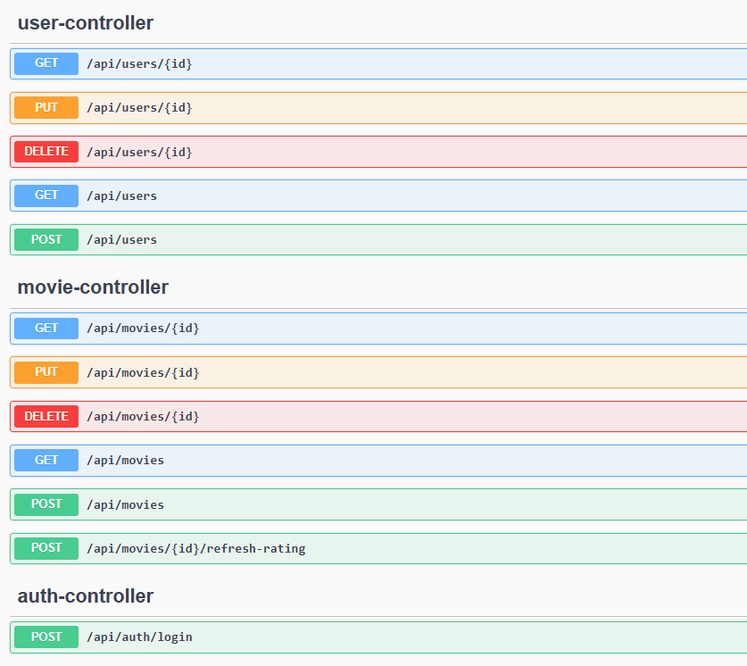

# Secure Movie Library

A Spring Boot REST API for managing a catalog of movies, secured with 
JWT-based authentication/authorization and enriched in the background 
with IMDb ratings pulled from OMDb.

This is my Final Progress Review project to complete Telerik Alpha's
Java program, built within a week.

## Running it

Requires a MariaDB instance with a `movie_library` database already 
created (`CREATE DATABASE movie_library;`) - Flyway migrates the schema 
from there. DB/JWT/OMDb config is read from environment variables, see `application.yml`.

```
mvn spring-boot:run
```

This is mainly a server app so there is no frontend, but Swagger UI 
serves as a functional one for testing the API. Once it's running go to 
http://localhost:8080/swagger-ui.html, log in through `/api/auth/login` 
and paste the token into Authorize.



## Docs

- [Secure-Movie-Library-Project.md](Secure-Movie-Library-Project.md) - 
  the original project requirements


- [TECHNICAL_OVERVIEW.md](TECHNICAL_OVERVIEW.md) - 
Serves as documentation and a needed deliverable.
